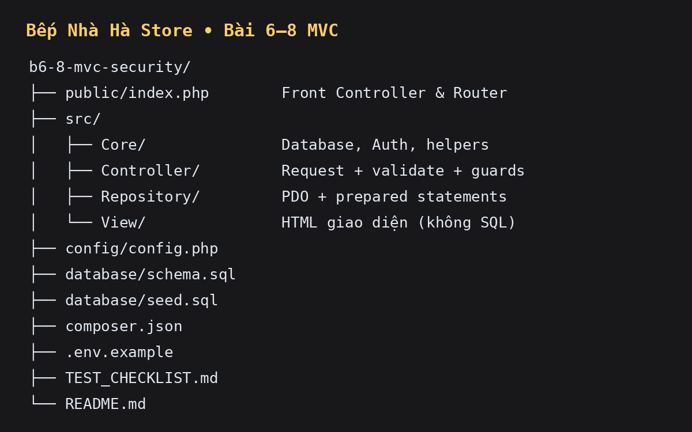

# Bài tập Bài 6–8 — PHP MVC, bảo mật và Fetch API

**Học phần:** Lập trình Web  
**Sinh viên thực hiện:** **Bùi Thị Hồng Hà** — bài làm cá nhân.  
**Đề tài áp dụng:** Hệ thống bán hàng trực tuyến mini **Bếp Nhà Hà Store**.



## 1. Kết quả đối chiếu từng yêu cầu slide

### Bài 6 — PHP OOP, Composer và MVC

| Yêu cầu | Cách đáp ứng trong repository |
|---|---|
| Refactor CRUD sang `Controller + Repository + View` | `ProductController`, `ProductRepository`, các View trong `src/View/admin/products/`. |
| View không chứa SQL | View chỉ render biến; mọi SQL nằm tại `src/Repository/`. |
| Controller không chứa HTML dài | Controller chỉ nhận request, validate, kiểm tra quyền/CSRF, gọi Repository rồi nạp View. |
| Repository chịu trách nhiệm truy vấn | `ProductRepository`, `UserRepository`, `OrderRepository` nhận PDO bằng constructor (dependency injection cơ bản). |
| Route chạy qua `public/index.php` | `public/index.php` là Front Controller/router duy nhất. |
| Composer PSR-4 autoload | `composer.json` ánh xạ `App\` → `src/`; chạy `composer dump-autoload`. |
| Có mô tả trước/sau refactor | Có ngay bên dưới. |

**Trước refactor:** Một file PHP thường vừa đọc `$_POST`, vừa viết SQL/PDO, vừa in HTML. Việc này làm khó kiểm thử và dễ đưa SQL vào giao diện.

**Sau refactor:** `public/index.php` chọn route → Controller validate/guard → Repository thực hiện PDO prepared statement → View hiển thị dữ liệu. Ví dụ CRUD admin: `admin/products/store` → `ProductController::store()` → `ProductRepository::create()` → redirect `admin/products` (PRG).

### Bài 7 — Xác thực, phân quyền và bảo mật

| Yêu cầu | Hiện thực |
|---|---|
| Đăng nhập/đăng xuất | `AuthController::login/logout`; session được tái tạo ID sau login (`session_regenerate_id(true)`). |
| `password_hash` / `password_verify` | `database/seed.sql` lưu bcrypt hash; `AuthController` dùng `password_verify()`, không so sánh mật khẩu rõ. |
| Guard role ở server | `Auth::requireRole()`: `admin` mới quản trị CRUD; `customer` mới đặt/hủy đơn. Không chỉ ẩn nút. |
| Ownership | `OrderRepository::findByUser()` và câu `UPDATE ... WHERE id=:id AND user_id=:user_id`: khách không thể hủy đơn của người khác. |
| CSRF | `Auth::csrfToken()` và `Auth::verifyCsrf()` bảo vệ POST login, logout, CRUD, đặt/hủy đơn; sai token trả 419. |
| Luồng đặt hàng | Customer + CSRF + `SELECT ... FOR UPDATE` kiểm tra tồn + transaction tạo đơn/chi tiết/trừ kho/log. |

### Bài 8 — JSON, Fetch API, kiểm thử và release candidate

| Yêu cầu | Hiện thực |
|---|---|
| Endpoint JSON | `GET ?route=api/products&q=...`, `ApiProductController::search()`. Chỉ trả id, SKU, tên, giá, tồn kho, danh mục; không lộ mật khẩu/role. |
| Live search không reload | `src/View/products/index.php`: Fetch + `async/await`, debounce 300ms. |
| Loading/error/empty | Có vùng `aria-live`; hiển thị “Đang tải”, lỗi HTTP và không tìm thấy kết quả. |
| DOM an toàn | Tạo node qua `document.createElement`; đưa dữ liệu bằng `textContent`; không dùng `innerHTML` cho response API. |
| Checklist test | Xem [`TEST_CHECKLIST.md`](TEST_CHECKLIST.md). |
| Hướng dẫn cài đặt/tài khoản | Có tại mục 3 và 4. |
| Kịch bản demo/báo cáo | Xem [`DEMO_SCRIPT.md`](DEMO_SCRIPT.md). |

## 2. Ma trận route

| Method | Route | Ai được dùng | Bảo vệ server | Mục đích |
|---|---|---|---|---|
| GET | `?route=products` | Tất cả | Public | Trang thực đơn + live search |
| GET/POST | `?route=login` | Khách chưa login | CSRF ở POST | Đăng nhập |
| POST | `?route=logout` | Đã login | CSRF | Đăng xuất |
| GET | `?route=admin/products` | Admin | `requireRole(['admin'])` | Danh sách CRUD admin |
| GET | `?route=admin/products/create` | Admin | Role guard | Form tạo |
| POST | `?route=admin/products/store` | Admin | Role + CSRF + validate | Lưu sản phẩm |
| GET/POST | `?route=admin/products/edit&id={id}` / `update&id={id}` | Admin | Role + CSRF ở POST | Sửa sản phẩm |
| POST | `?route=admin/products/delete` | Admin | Role + CSRF | Xóa sản phẩm |
| POST | `?route=orders/create` | Customer | Role + CSRF + tồn kho + transaction | Đặt một sản phẩm |
| POST | `?route=orders/cancel` | Chủ đơn (customer) | Role + CSRF + ownership | Hủy đơn pending của chính mình |
| GET | `?route=api/products&q={keyword}` | Tất cả | JSON không nhạy cảm | Tìm sản phẩm tối đa 10 kết quả |

## 3. Cài đặt

**Yêu cầu:** PHP 8.1+, Composer, MySQL/MariaDB, extensions `pdo_mysql` và `mbstring`.

```bash
git clone https://github.com/BuiThiHongHa/b6-8-mvc-security.git
cd b6-8-mvc-security
composer install
# Tạo database và dữ liệu mẫu
mysql -u root -p < database/schema.sql
mysql -u root -p < database/seed.sql
# Tùy chọn: sao chép biến môi trường rồi sửa thông tin DB
cp .env.example .env
php -S 127.0.0.1:8000
```

Mở: `http://127.0.0.1:8000/index.php?route=products`.

> Khi dùng Apache, DocumentRoot cần trỏ đến thư mục `public/`. File `config/config.php` nhận `DB_HOST`, `DB_PORT`, `DB_NAME`, `DB_USER`, `DB_PASS` từ environment. Không commit file `.env` có mật khẩu thật.

## 4. Tài khoản test và ma trận quyền

Mật khẩu mẫu cho mọi tài khoản: **`1234567890`**. Mật khẩu trong DB là **bcrypt hash**, không phải văn bản thô.

| Vai trò | Email | Quyền cần demo |
|---|---|---|
| Admin | `admin@example.com` | Vào `/admin/products`, CRUD sản phẩm |
| Staff | `staff@example.com` | Không được truy cập quản trị sản phẩm (403) |
| Customer Minh | `minh.nguyen@example.com` | Đặt món, chỉ hủy đơn thuộc `user_id=3` |
| Customer Hoa | `hoa.pham@example.com` | Không được hủy đơn của Minh |

## 5. Cấu trúc và phân công

```text
public/                 Front Controller và routing
a src/Core/             Database PDO, Auth, helpers
src/Controller/         Điều phối request, validate, guard
src/Repository/         Các truy vấn PDO/prepared statement
src/View/               Giao diện HTML tách SQL
config/                 Cấu hình DB
database/               schema.sql + seed.sql
```

Bài làm cá nhân nên **Bùi Thị Hồng Hà** phụ trách toàn bộ: `ProductRepository`/CRUD MVC, `Auth`/bảo mật/CSRF/ownership, endpoint API/Fetch, CSDL/README/checklist/demo. Các commit được chia theo phần MVC, bảo mật và API để thể hiện tiến độ.

## 6. Ràng buộc CSDL và kỹ thuật cần trình bày

- `users.email`, `users.username`, `products.product_code`, `products.slug`, `orders.order_code` là UNIQUE.
- Khóa ngoại bảo vệ tính toàn vẹn giữa role-user, category-product, order-order_item.
- `products.stock_quantity >= 0` và giá bán không âm có CHECK constraint.
- Tất cả input request đi vào SQL qua `prepare()/execute()` hoặc bind tham số; `LIMIT` được bind `PDO::PARAM_INT`.
- Đặt hàng khóa sản phẩm bằng `FOR UPDATE`, kiểm tồn, tạo đơn + item + trừ kho + ghi log trong một transaction; lỗi sẽ rollback.
- Lỗi thực tế đã gặp khi làm bài: MySQL/XAMPP chưa chạy dẫn đến PDO `SQLSTATE[HY000] [2002] Connection refused`. Cách xử lý: bật MySQL, import lần lượt `schema.sql`, `seed.sql`, rồi kiểm tra DB name trong environment/config.

## 7. Evidence kiểm thử

- Kiểm tra cú pháp: `find . -path './vendor' -prune -o -name '*.php' -type f -print0 | xargs -0 -n1 php -l`.
- Kết quả kiểm thử chức năng chi tiết: [`TEST_CHECKLIST.md`](TEST_CHECKLIST.md).
